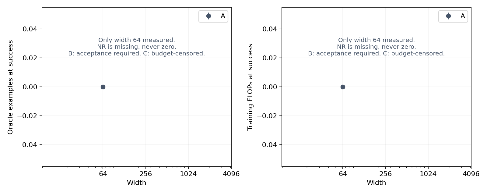
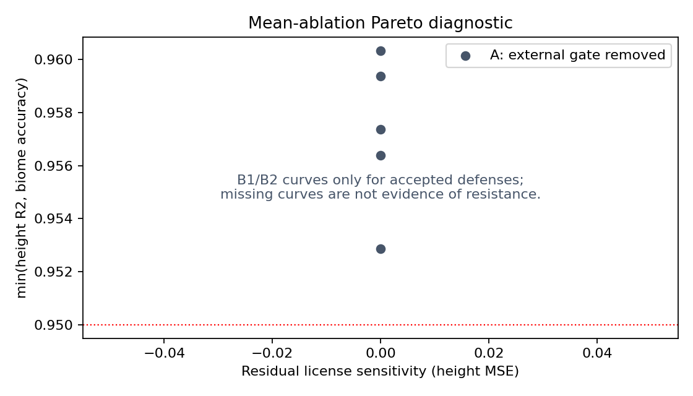
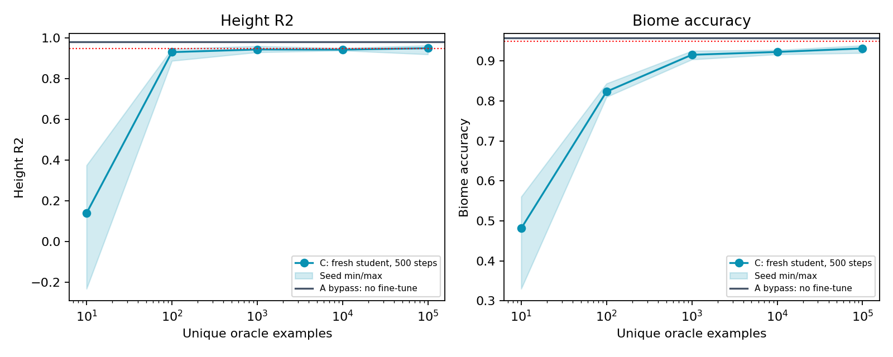
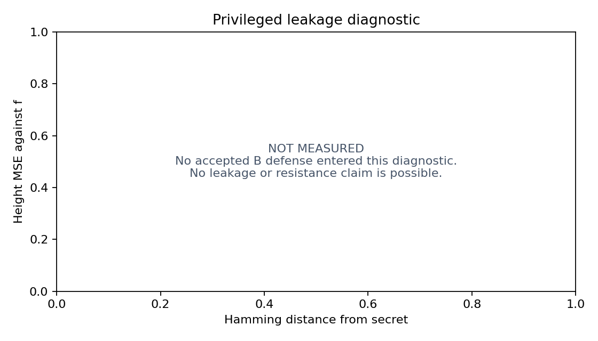
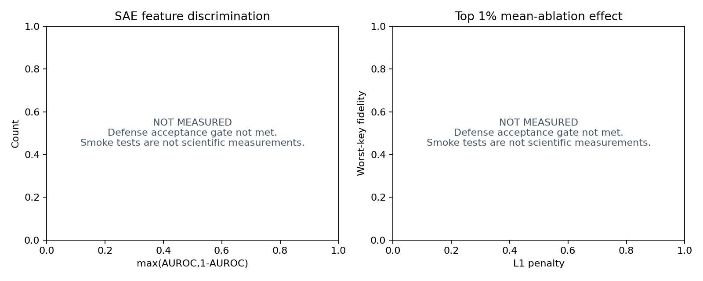
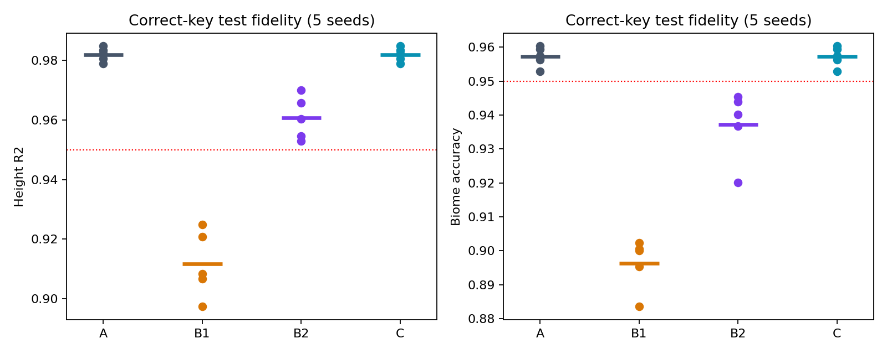

# Entangled DRM — Faz 0 deney raporu

## 1. Özet
Lisans ile görev hesaplamasını aynı ağda eğitmenin bypass maliyetine etkisi sınandı.
Asıl sekiz hücreli ızgaranın width=64, c=4 hücresi beş tohumla çalıştırıldı.
Ayrık A kapısı sıfır optimizasyon/oracle maliyetiyle kaldırıldı: 5/5 H1 başarısı.
B1/B2 için eğitim kabulünü geçen koşu: 0/10.
Bu eğitim bütçesiyle çalışan entangled savunma kurulamadı; bu bir bypass bulgusu değildir.
H2 ve H3 değerlendirilemedi; fikir ne doğrulandı ne çürütüldü.
Karar tablosundaki dört sonuçtan hiçbirini seçmek için yeterli kanıt yoktur.
Tam genişlik ölçeklemesi ve asıl tam ızgara tamamlanmadı.

## 2. Kurulum
Deterministik hash-grid smoothstep value noise; 4 oktav, başlangıç frekansı 2,
genlikler 1, 1/2, 1/4, 1/8. Teorik genlik toplamıyla [0,1] normalizasyonu yapılır.
Height ve bağımsız moisture alanından su/ova/orman/dağ sınıfları üretilir.
f seed=123, decoy g seed=9871. Her tohumda ayrı 65536 train, 4096 validation,
100000 test koordinatı; tüm havuzların gerçek kesişimi kontrol edilir.
Test height varyansı R² paydasında kullanılır. Fidelity her zaman R²≥0.95 **ve**
biome accuracy≥0.95; tek başına bir metrik yeterli değildir.
A/C dört GELU gizli katman, width64; B1 [x,y,k] girişi, B2 sabit 64→16 projection
ve her katmanda öğrenilen FiLM. B2'de açık eşitlik kapısı yoktur; modülasyon yolu
mimaride görünürdür, “yorumlanamaz” olduğu varsayılmamıştır.
64-bit secret her seed için farklı; eğitim %50 valid, %25 uniform-wrong,
%12.5 Hamming-1, %12.5 Hamming-2. B eğitiminde tüm parametreler ortaktır.
Adam lr=.001, batch512, 6000 adım; loss=10×height MSE + biome cross-entropy.
A ve C aynı başlangıç ve veriyi kullandığından full-data çıktıları aynıdır;
bunlar bağımsız iki deneysel örnek gibi sayılmamıştır.

## 3. Sağlama ve düzeltmeler
İlk 2000-adımlı pilot: R²=0.969713, accuracy=0.943330.
Biome eşiği geçilmedi; B/C/saldırılar bu pilotta başlatılmadı ve koşu silinmedi.
6000-adımlı yeni bütçe sonuç görülmeden `3d5a261` commit'inde kaydedildi.
A'nın doğru görev ve decoy ağları kabul eşiğini geçti. Kapı silme H1=5/5.
Kapı silme, f ağını aynen döndürür; tam eşitlik unit test ile doğrulandı.
H1 eğitiminde başarısız ilk koşu ana beşli ortalamaya katılmadı, ayrıca raporlandı.
Bağımsız kod incelemesindeki üç kayıt sorunu düzeltildi: NaN/Inf değerleri alan
konumuyla null kaydı, saldırı öncesinde kabul kaydının kalıcılaştırılması ve
100000 test altındaki bilimsel konfigürasyonların reddi. Bunlar mimariyi, loss'u,
eğitim bütçesini veya sayısal kabul eşiğini değiştirmedi.

| Kol | Başlatılan | Kabul | Eğitim başarısız | Sürüyor |
|---|---|---|---|---|
| A | 5 | 5 | 0 | 0 |
| B1 | 5 | 0 | 5 | 0 |
| B2 | 5 | 0 | 5 | 0 |
| C | 5 | 5 | 0 | 0 |

Doğru anahtar test metriği: **ortalama [min, max]**, beş tohum; güven aralığı değildir.

| Kol | n | Height R² | Biome accuracy |
|---|---|---|---|
| A | 5 | 0.9820 [0.9788, 0.9848] | 0.9573 [0.9529, 0.9603] |
| B1 | 5 | 0.9116 [0.8973, 0.9249] | 0.8963 [0.8835, 0.9023] |
| B2 | 5 | 0.9607 [0.9529, 0.9700] | 0.9373 [0.9202, 0.9454] |
| C | 5 | 0.9820 [0.9788, 0.9848] | 0.9573 [0.9529, 0.9603] |

Yanlış anahtarda decoy g'ye fidelity, her stratumda test başına yeni anahtarlar:

| Kol | Stratum | n | Decoy R² | Decoy accuracy |
|---|---|---|---|---|
| B1 | random | 5 | 0.8973 [0.8902, 0.9086] | 0.8619 [0.8556, 0.8715] |
| B1 | h1 | 5 | 0.8255 [0.7559, 0.8862] | 0.8755 [0.8685, 0.8854] |
| B1 | h2 | 5 | 0.8956 [0.8733, 0.9104] | 0.8763 [0.8698, 0.8827] |
| B2 | random | 5 | 0.9233 [0.9129, 0.9339] | 0.8990 [0.8944, 0.9049] |
| B2 | h1 | 5 | 0.9512 [0.9399, 0.9592] | 0.9335 [0.9282, 0.9389] |
| B2 | h2 | 5 | 0.9467 [0.9394, 0.9540] | 0.9308 [0.9257, 0.9363] |

## 4. Bulgular ve saldırılar
**Kapı silme:** A sıfır öğrenme maliyetiyle başarılıdır. Bu maliyete savunma eğitimi
ve dosya kopyalama maliyeti eklenmez. B ablasyonu yalnız kabul edilen savunmalarda
bilimsel veri sayılır. Şekil 2'de olmayan B eğrileri sıfır hassasiyet anlamına gelmez.

**Fine-tune:** Sabit all-minus-one anahtar, 10/100/1000/10000/100000 örnek,
500 adım ve üç LR (.0001/.001/.01) kodlandı. LR validation ile seçilir;
başarı altı yanlış anahtarın tamamında ölçülür. Kabul edilmeyen B modelleri üzerinde
saldırı yapılmadı. Eğitim başarısızlığı fine-tune direnci olarak yorumlanamaz.

**Anahtar kurtarma:** 1000 oracle örneği, 20 başlangıç, 1000 optimizasyon adımı;
sürekli [-1,1] anahtar sonunda ±1'e yuvarlanır. Secret bu optimizasyona verilmez.
Kabul edilen anahtarı bulmak ile altı bağımsız yanlış anahtarda bypass farklıdır.
Geçerli B yokken bilimsel kurtarma sonucu yoktur. Şekil 4 Hamming paneli ölçüm
yokluğunu açıkça gösterir; bir “gradyan yok” eğrisi değildir.

**Distillation / C:** Hatasız analitik f oracle'ı kullanıldı; lisanslı ağın hatalı
çıktılarını öğrenmekten daha güçlü bir erişimdir. Her n'de sıfırdan öğrenci,
aynı 500 adım ve üç LR; en iyi LR validation üzerinde seçilir. C full-data eğitim
başarısıyla, kısa bütçeli C örnek eğrisi karıştırılmamalıdır. Şekil 3'ün min/max
bandı tohumlar arası dağılımı verir. Eşik aşılmadığında minimum örnek sayısı veya
minimum FLOPs bilinmez; 10x oranı çıkarılamaz.

**SAE/probe:** 2. gizli katman, 8x expansion, üç L1, AUROC; en ayırt edici %1
özellikte valid-mean ablation ve lisans probe yönünün çıkarılması kodlandı.
SAE müdahalesi reconstruction residual'ını korur; salt reconstruction hatasıyla
ablasyon etkisi karıştırılmaz. Küçük yapay modelde tüm beş saldırı boru hattı
çalıştırıldı; bunlar yalnız smoke testtir, bilimsel deney değildir. Geçerli B
kabulü yokken Şekil 5'te AUROC/ablasyon/probe sonucu üretilmedi.
Bilimsel B saldırı ledger girişleri: 0; hata sayısı: 0.

| Şekil | İçerik |
|---|---|
|  | Tek genişlik ve ölçülmeyen maliyetler açıkça işaretli |
|  | A bypass referansı; B kabul kapısı |
|  | C örnek eğrisi ve A gate-removal referansı |
|  | Geçerli B için ölçüm durumu |
|  | Geçerli B için ölçüm durumu |
|  | Her tohumda doğru-anahtar fidelity |

Yüksek fidelity'ye ulaşma maliyeti; NR=denenen bütçede eşik maliyeti **ölçülmedi**,
∞ veya 0 değildir. Arama FLOPs'u başarısız LR denemelerini içerir.

| Kol | Width | Eşik bulunan seed | Oracle n ort. [min,max] | Arama FLOPs ort. [min,max] | Durum |
|---|---|---|---|---|---|
| A | 64 | 5 | 0 [0, 0] | 0 [0, 0] | Kapı silme |
| B1 | 64 | 0 | Ölçülmedi | Ölçülmedi | NR — eğitim kabulü yok |
| B2 | 64 | 0 | Ölçülmedi | Ölçülmedi | NR — eğitim kabulü yok |
| C | 64 | 0 | Ölçülmedi | Ölçülmedi | NR — test edilen 500-adım/3-LR bütçesi |

Savunma eğitimi toplamı: 7168665600000 yaklaşık FLOPs; C saldırı/öğrenme LR
aramaları toplamı: 1497254400000 FLOPs. İlk pilot ve tekrar üretim bunun dışında
ayrı loglarda saklanır. Duvar saatleri eşzamanlı koşulardan dolayı doğrudan işlem
maliyeti karşılaştırması değildir. Bir C hücresinde n başına seçilmiş koşu
maliyeti 6×12997×(500×512)=19963392000 FLOPs;
üç LR toplamı bunun üç katıdır. A bypass/savunma-eğitimi=0.
B saldırı/savunma-eğitimi ve B/C oranları eksik maliyetlerden dolayı tanımsızdır.
A=0 olduğundan B/A çarpımsal oranı da tanımsız; epsilon eklenmedi.

## 5. Hipotez değerlendirmesi
| Hipotez | Sonuç | Sayısal/ölçümsel gerekçe |
|---|---|---|
| H1 | GEÇTİ | 5/5 başarılı kapı silme; ilk 2000-adım pilotu ayrıca başarısız |
| H2 | DEĞERLENDİRİLEMEDİ | 0/10 kabul edilen B; geçerli B Pareto verisi olmadan geçti/kaldı denemez |
| H3 | DEĞERLENDİRİLEMEDİ | Tek genişlik; B maliyeti eksik; C kısa bütçe sansürü; A=0 oranı tanımsız |

Kullanıcının karar tablosu aynen korunmuştur:

| Sonuç | Anlamı |
|---|---|
| H2 ve H3 geçiyor | Fikir çalışıyor; Faz 1'e geçilir |
| H2 geçiyor, H3 düşüyor (az örnekle açılıyor) | Statik analize karşı iyi, fine-tune'a karşı zayıf; min-max eğitim eklenmeli |
| İkisi de düşüyor | Entanglement ayrık kapıdan farksız; fikir bu formda çürüdü, nedeni raporlanır |
| Her şey C'ye çöküyor | Güvenlik tavanı fonksiyonun öğrenme karmaşıklığı; bu ölçülmüş bir sınır olarak raporlanır |

**Bu deneyin etiketi: karar için yetersiz — eğitim kabul kapısında takıldı.**
H2/H3 ölçülmediği için “ikisi de düştü” denemez. C'ye çökme de ölçülmedi.

## 6. Ölçekleme analizi
Yalnız width64,c4 ölçüldü; 8 hücrenin 1'i, 40 seed-konfigürasyonun 5'i.
Diğer 35 seed-konfigürasyon (140 kol) başlatılmadı. Bu oturumdaki sonuçlar
width256/1024/4096 veya c2/c8 hakkında bir iddia desteklemez.
Yorumlanabilirlik ve saldırı maliyeti arasında Pearson/Spearman **NA**:
yeterli eşleşmiş gözlem yok. Sıfır korelasyon raporlamak da yanlış olurdu.
FLOPs tahmini parametre sayısı ile çarpılır; FiLM'in sabit projection maliyeti ve
probe sklearn solver'ı bu kaba 6PS tahminine tam dahil değildir.

## 7. Sınırlamalar
Oyuncak MLP gerçek oyun motoru değildir. Dağıtık temsil/süperpozisyon bu kurulumda
bağımsız bir ölçütle doğrulanmadı; B etiketi başlı başına entanglement kanıtı değil.
Lisanslı çalışma belleğinden anahtar/parametre yakalama (T4) kapsam dışı ve baştan
kırılır kabul edildi. Yerel ağırlıklar kopyalanabilir; yorumlanamazlık kopya direnci
sağlamaz. Saldırı paketi sınırlı; daha akıllı saldırılar sonucu değiştirebilir.
Ablasyon/SAE/Hamming doğru lisanslı aktivasyon erişimi olan ayrıcalıklı teşhisler;
gizli anahtarı bilmeyen saf statik saldırı gibi sunulmadı. Ham B1 anahtarından
ağırlık analiziyle bit çıkarma gibi ek güçlü saldırılar burada ölçülmedi.
CPU'da daraltılmış kapsam, 6000 savunma adımı ve 500 saldırı adımı farklı
soruları sansürler. Hatalar, NaN, yarım kalan ve eğitim başarısızlıkları silinmez.

## 8. Sonraki adımlar
Faz 1 güvenlik iddiasına geçilmemeli. Önce aynı %95 eşiklerle B1/B2 için eğitim
kabulünü sağlayan bütçe/mimariyi ayrı ve önceden kayıtlı deneyde bulmak gerekir.
A/C ile adil kapasite ve optimizasyon bütçesi karşılaştırması korunmalı.
Kabul edilen modellerde tüm saldırılar, 5 seed ve en az üç genişlik çalıştırılmalı;
C'ye eşik aşabilecek eğitim bütçesi verilmeli. Ancak bundan sonra maliyet oranı
ve ölçekleme değerlendirilebilir. Min-max eğitim ancak çalışan B savunmasının
fine-tune ile açıldığı gösterilirse gerekçelendirilmiş sonraki aday olur.

## 9. Ek — konfigürasyonlar, süreler, başarısız koşular
`configs/pilot.json`, `pilot_repair.json`, `cpu_seed1..4.json` ölçülen bütçeler;
`configs/full_grid.json` asıl ızgarayı çalıştırır, çalıştırılmış sonuç değildir.
Ham sonuçlar config+seed, fidelity, yanlış-key strata, parametre sayısı, işlenen
örnek, FLOPs, loss geçmişi ve süreyi içerir. Savunma checkpoint'lerinde secret
bulunur; saldırı API'lerine aktarılmaz. İlk pilot ayrıca `results/pilot_001`.

| Kol | Seed | Durum | Saniye | Eğitim FLOPs |
|---|---|---|---|---|
| A | 0 | accepted | 44.48 | 239560704000 |
| B1 | 0 | training_failed | 54.78 | 315058176000 |
| B2 | 0 | training_failed | 100.06 | 399992832000 |
| C | 0 | accepted | 41.88 | 239560704000 |
| A | 1 | accepted | 47.95 | 239560704000 |
| B1 | 1 | training_failed | 58.72 | 315058176000 |
| B2 | 1 | training_failed | 61.74 | 399992832000 |
| C | 1 | accepted | 54.67 | 239560704000 |
| A | 2 | accepted | 46.33 | 239560704000 |
| B1 | 2 | training_failed | 53.18 | 315058176000 |
| B2 | 2 | training_failed | 54.96 | 399992832000 |
| C | 2 | accepted | 67.98 | 239560704000 |
| A | 3 | accepted | 56.77 | 239560704000 |
| B1 | 3 | training_failed | 56.35 | 315058176000 |
| B2 | 3 | training_failed | 64.21 | 399992832000 |
| C | 3 | accepted | 57.60 | 239560704000 |
| A | 4 | accepted | 95.18 | 239560704000 |
| B1 | 4 | training_failed | 50.44 | 315058176000 |
| B2 | 4 | training_failed | 59.32 | 399992832000 |
| C | 4 | accepted | 74.10 | 239560704000 |

Bilimsel beşli kayıt sayısı 20/20; sürüyor 0;
yürütme hatası 0;
NaN alan işaretli 0.
NaN denetimi regresyon testinde yapay NaN ile doğrulandı; bu bilimsel NaN koşusu değil.
`results/metrics.csv`, `costs.csv`, `acceptance.csv` yeniden üretilebilir tablolardır.
Preregistration SHA256: `d6e063d09a60c32b8b311336a647a57aefc60765be8473d8e68fe31702353261`. Git'te ilk commit ile byte eşitliği ayrıca doğrulanır.
Kod incelemesi üç önemli kayıt sorununu saptadı; regresyonlarla düzeltildi.
Tam istenen ızgaranın ve güvenlik hipotezlerinin tamamlandığı iddia edilmemektedir.
